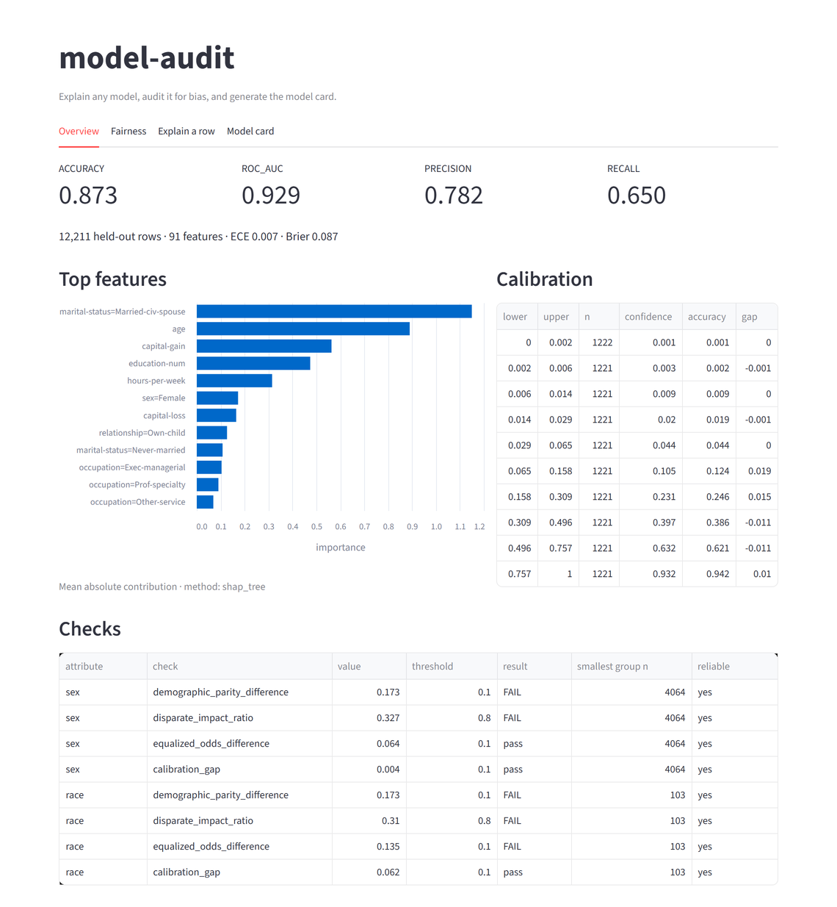
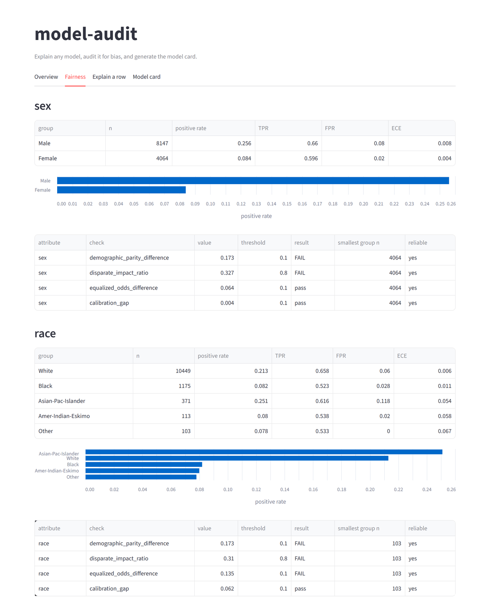
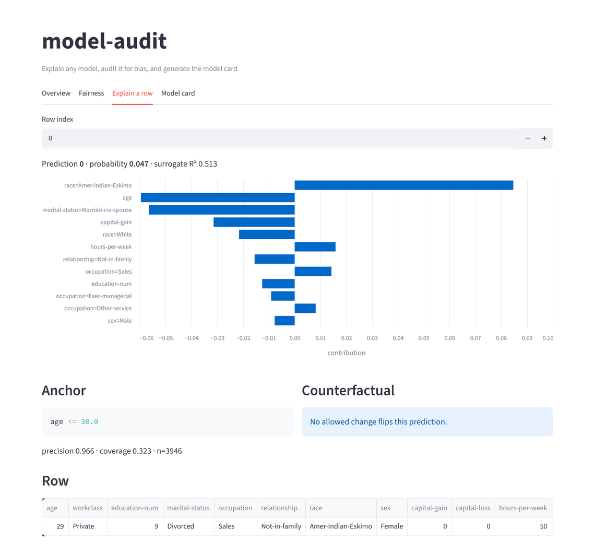

# model-audit

Explain any fitted model, audit it for bias, and generate the model card — from one object.

[](https://github.com/Emart29/model-audit/actions/workflows/ci.yml)

**Live demo: [model-audit.streamlit.app](https://model-audit.streamlit.app)** — the full audit on
the Adult census data, reproducing every number below. The first load trains the model and takes
about a minute; an idle app sleeps and wakes on the next visit.

**Write-up:** [My Model Was 87% Accurate and Almost Perfectly Calibrated. It Still Selected Men at
Three Times the Rate of Women](https://medium.com/towards-artificial-intelligence/my-model-was-87-accurate-and-almost-perfectly-calibrated-d7732cd516ef)
(Towards AI)

Most portfolios show a model being built. This one shows a model being **audited**, which is
the step that decides whether it ships. Point it at a fitted scikit-learn, XGBoost or PyTorch
model and it produces global and local explanations, a fairness audit, counterfactuals,
anchors, a calibration check, and a model card in Markdown, JSON and PDF.

The methods are implemented here rather than imported, so every number can be traced to the
code that produced it.

---

## The result

A gradient-boosted model on the UCI Adult census extract, scored on a held-out split of
**12,211 rows** (25% of 48,842), 91 encoded features, `income > $50K` as the target:

| | value |
|---|---|
| Accuracy | **0.873** |
| ROC AUC | **0.929** |
| Brier | **0.087** |
| Expected calibration error | **0.007** |

By the usual measures this is a good model. It is also unfair on both protected attributes:

| Attribute | Check | Value | Threshold | Result |
|---|---|---:|---:|---|
| sex | demographic parity difference | 0.173 | ≤ 0.10 | **fail** |
| sex | disparate impact ratio | 0.327 | ≥ 0.80 | **fail** |
| sex | equalized odds difference | 0.064 | ≤ 0.10 | pass |
| sex | calibration gap | 0.004 | ≤ 0.10 | pass |
| race | demographic parity difference | 0.173 | ≤ 0.10 | **fail** |
| race | disparate impact ratio | 0.310 | ≥ 0.80 | **fail** |
| race | equalized odds difference | 0.135 | ≤ 0.10 | **fail** |
| race | calibration gap | 0.062 | ≤ 0.10 | pass |

**5 of 8 checks fail.** The model predicts `> $50K` for 25.6% of men and 8.4% of women
(n = 8,147 and 4,064). It is accurate *and* well calibrated *and* still selects men at three
times the rate of women. That is the point of the project: accuracy and calibration do not
imply fairness, and a report that only shows the first two is not an audit.

One more finding from the explanations: `sex=Female` is the **6th most important feature** by
mean absolute SHAP: 0.176 in log-odds over all 12,211 held-out rows, above capital loss and every
occupation indicator. The rank is stable: 6th on the full set and on every 500-row sample
checked (the report's ranking uses a 500-row sample for speed, which gives 0.173). The model is
not inferring sex from proxies; it is using the column.

Caveats, stated up front:

- Adult is a **1994** census extract. `$50K` is a 1994 threshold, and the base rates in it are
  not today's.
- Race groups are small at the tail: `Other` n = 103, `Amer-Indian-Eskimo` n = 113. Every
  group's n is printed next to its rate; a gap on 103 people is a signal to look, not a
  finding to publish.
- The fairness metrics are **descriptive**. They quantify gaps in this dataset. They do not
  establish that the model is unlawful, and they do not prove discrimination.
- The thresholds (0.10, 0.80) are conventions from fairness tooling and US employment
  guidance, not laws. They are arguments to every function, and the report prints the ones
  used.



<details>
<summary>Fairness by group, and a single row explained</summary>





</details>

---

## What broke

These are the bugs that would have made the published output wrong. All were found by
running the full audit and looking at it, after all 38 tests had passed.

- **Counterfactuals suggested sentinel values.** Candidate values came from each column's
  0/25/50/75/100th percentiles. Capital-gain is zero up to the 75th percentile, so the only
  alternative ever tried was the maximum, 99,999, which is the dataset's cap code and not a
  real income. Every rejected applicant was told to "raise capital-gain from 0 to 99,999".
  The grid now runs from the 1st to the 99th percentile, and a test pins it.
- **The fix exposed a second problem.** With the cap gone, every row got the same advice:
  "have $15,024 of capital gains". That is true for the model and useless to a person, because
  capital gain measures wealth, not a choice. The demo now treats capital gain and loss as
  non-actionable. The search then proposes changes to education, hours, occupation and sector,
  and returns nothing for rows it cannot honestly flip: 17 of the first 40 rejected rows.
- **The importance chart was not ranked.** The UI's bar chart sorted features alphabetically,
  so `age` appeared first and `sex=Female` last. Charts are now drawn in value order.
- **The demo disagreed with this README.** It defaulted to a 12,000-row sample. That left
  26 people in the smallest race group and moved race equalized-odds from 0.135 to 0.647. The
  UI did warn about it, but only on one tab. The demo now defaults to the full dataset, and
  every check carries its smallest group's n.

---

## Architecture

```
        raw frame (CSV / DataFrame)
                 │
                 ▼
        ┌──────────────────┐
        │ Encoder          │  one-hot, median fill, learned category levels
        └────────┬─────────┘
                 │ X (numeric matrix)
                 ▼
        ┌──────────────────┐
        │ ModelAuditor     │  holds model + X + y + protected attributes
        └────────┬─────────┘
                 │
   ┌─────────┬───┴────┬───────────┬──────────────┐
   ▼         ▼        ▼           ▼              ▼
 Global    Local    Anchors   Counterfactuals  Fairness + calibration
 SHAP      surrogate  greedy    greedy search   DP / DI / EO / ECE
   │         │        │           │              │
   └─────────┴────────┴───────────┴──────────────┘
                 │
                 ▼
        ┌──────────────────┐
        │ Report + card    │  Markdown · JSON · PDF
        └────────┬─────────┘
                 │
        ┌────────┴─────────┐
        ▼                  ▼
   Streamlit UI       FastAPI /metrics /fairness /explain ...
```

---

## What each piece does

| Piece | Method | Why it is here |
|---|---|---|
| **Global** | SHAP `TreeExplainer` for trees, `LinearExplainer` for linear models, permutation importance otherwise | Exact and fast where it can be; the method that ran is recorded on every row |
| **Local** | Ridge surrogate on distance-weighted perturbations (the LIME construction) | Recovers the sign of the true coefficients on a linear model — there is a test for it |
| **Anchors** | Greedy rule growth to a precision target with a coverage floor | Reports precision *and* coverage, and flags when it cannot reach the target |
| **Counterfactuals** | Search over raw feature values, immutable features excluded | A suggestion you are not allowed to act on is not a counterfactual; no flip, no result |
| **Fairness** | Demographic parity, disparate impact, equalized odds, calibration gap | Each with its threshold and every group's n |
| **Calibration** | ECE, MCE, Brier, reliability bins | Catches the model that is accurate overall but over-confident for one group |
| **Model card** | Auto-filled from the audit | JSON for machines, Markdown for the repo, PDF for a reviewer |

### Deliberate choices

- **No `fairlearn`, no `aif360`, no `lime`, no `dice`, no `alibi`.** The metrics are short
  enough to read and test, and a toolkit whose definitions you cannot inspect is not an audit
  tool. The one external explanation dependency is `shap`, because reimplementing exact tree
  SHAP is a research project, not a feature.
- **Encoded matrix in, raw frame for counterfactuals.** Explanations need numbers;
  counterfactuals need names a person can act on. `Encoder` is the only bridge.
- **Small groups are not hidden.** `AttributeAudit.reliable` is false below `min_group_size`,
  and both the report and the UI say so.
- **Counterfactual candidates stop at the 1st and 99th percentiles.** Raw extremes are often
  caps or sentinel codes, and a suggestion to move to one is not advice.
- **Kernel SHAP is capped.** Above 40 features on a non-tree model it would cost too much,
  so permutation importance runs instead and the report says so rather than claiming SHAP.

---

## Quickstart

```bash
python -m venv .venv
.venv/Scripts/activate        # Windows
pip install -e ".[app,api,pdf]"
```

Run the full audit (downloads Adult through scikit-learn on first run):

```bash
python -m model_audit demo --out reports
```

That prints the tables above and writes `reports/adult-report.md`,
`reports/adult-model-card.{json,md,pdf}` and `reports/numbers.json`.

Use it on your own model:

```python
from model_audit import ModelAuditor, fit_encoder

encoder = fit_encoder(train_df, categorical_features=["region", "group"])
X = encoder.transform(train_df.drop(columns=["target"]))

auditor = ModelAuditor(
    model, X, y,
    feature_names=encoder.feature_names,
    protected_attributes={"group": train_df["group"]},
    frame=train_df.drop(columns=["target"]),
    encoder=encoder,
    immutable_features=["age", "sex", "race"],
)

auditor.fairness()                 # tuple[AttributeAudit, ...]
auditor.global_importance()        # ranked list
auditor.local(0)                   # contributions for one row
auditor.counterfactuals(0, k=3)    # actionable flips, or nothing
auditor.anchors(0)                 # rule + precision + coverage
auditor.report("reports")          # md + json + pdf
```

PyTorch models return logits and have no `predict_proba`, so wrap the module once:

```python
from model_audit import ModelAuditor, TorchClassifier

auditor = ModelAuditor(TorchClassifier(net), X, y, feature_names=names)
```

XGBoost and LightGBM work as-is: SHAP picks them up through `get_booster()`.

Streamlit UI:

```bash
streamlit run app/streamlit_app.py
```

HTTP API:

```bash
python -m model_audit serve --port 8000
curl localhost:8000/fairness
curl localhost:8000/explain/local/0
curl localhost:8000/counterfactuals/0
```

---

## Repository layout

```
model-audit/
├── src/model_audit/
│   ├── auditor.py          # ModelAuditor: one object, all checks
│   ├── fairness.py         # DP, DI, EO, per-group stats
│   ├── calibration.py      # ECE, MCE, Brier, reliability bins
│   ├── explain_global.py   # SHAP / permutation
│   ├── explain_local.py    # ridge surrogate
│   ├── anchors.py          # greedy rule growth
│   ├── counterfactual.py   # constrained flip search
│   ├── model_card.py       # JSON / Markdown / PDF
│   ├── report.py           # the full audit report
│   ├── preprocessing.py    # Encoder: raw frame -> matrix
│   ├── adapters.py         # TorchClassifier: module -> sklearn protocol
│   ├── api.py              # FastAPI
│   └── cli.py              # demo + serve
├── app/streamlit_app.py
├── examples/               # a committed audit report and model card
├── tests/                  # 39 tests, known-answer where possible
└── reports/                # generated (gitignored)
```

---

## Tests

```bash
pytest
```

39 tests. The fairness and calibration tests use constructed cases with hand-computed
answers (a 0.9-confidence model that is right half the time has ECE 0.4 and Brier 0.41). The
explanation tests check properties rather than snapshots: the local surrogate recovers the
sign of a linear model's coefficients, its contributions reconstruct the prediction, and the
anchor always covers the instance it explains.

---

## What this does not do

- **No causal claims.** SHAP and counterfactuals describe the model's behaviour, not the
  world. "Changing education to Masters flips the prediction" does not mean education causes
  income.
- **No mitigation.** It measures gaps; it does not fix them. Reweighting, threshold
  adjustment and constrained training are separate work.
- **No multiclass fairness.** The checks are defined for binary outcomes and raise on
  anything else rather than silently doing something approximate.
- **No model training.** You bring the fitted model; this audits it.

---

MIT licensed.
